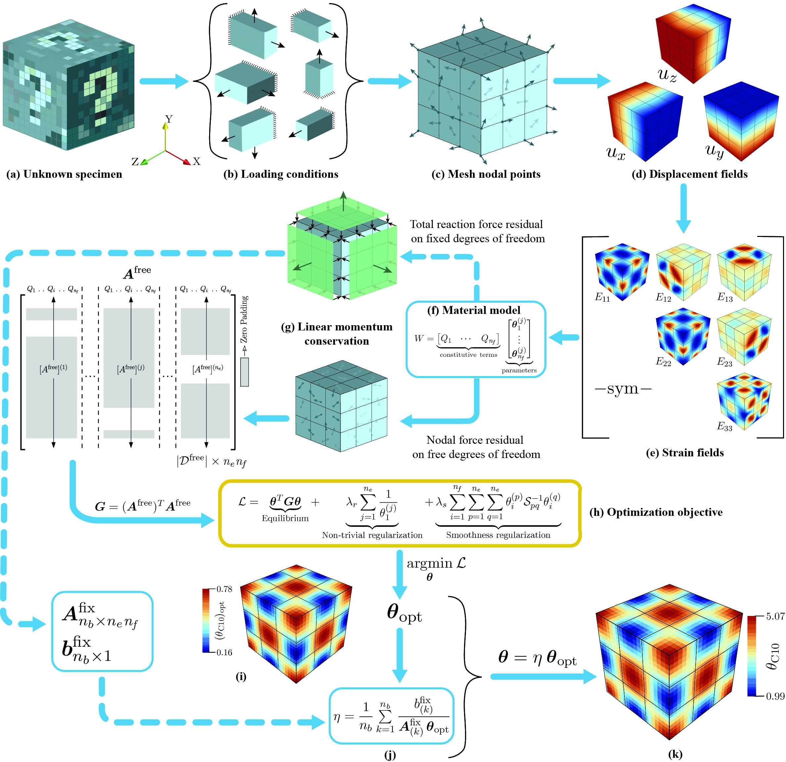

# FGM-hyperelasticity

Code accompanying the paper: **Equilibrium Gap-based approach for interpretable identification of constitutive parameter field for three-dimensional heterogeneous and graded hyperelastic materials from full-field displacements**

<p align="center">
  
</p>

---

## Contents
- [Repository structure](#repository-structure)
- [Installation](#installation)
- [Quick start](#quick-start)
- [3D specimens (FGM-3D)](#3d-specimens-fgm-3d)
- [In-plane specimens (FGM-2D)](#in-plane-specimens-fgm-2d)
- [Abaqus UMAT subroutines](#abaqus-umat-subroutines)
- [Input data format](#input-data-format)
- [Outputs](#outputs)
- [Adding a material model](#adding-a-material-model)
- [License](#license)
- [Citation](#citation)
- [Contact](#contact)

---


## Repository structure

```
FGM-hyperelasticity/
├── FGM-3D/                  3D specimens
│   ├── drivers/
│   │   ├── main_fgm_HEX.py      driver: preprocessing, training, post-processing
│   │   ├── models.py            material models and their training settings
│   │   ├── features_library.py  invariant-based constitutive terms
│   │   ├── preprocess_data_hetero.py  assembly of A_free, A_fix, b_fix
│   │   ├── config.py            fibre direction
│   │   ├── paraview_plot.py     VTK export
│   │   └── visuals_plot.py      histograms, parity plots, GMM fits
│   ├── core/                FE data loading, kinematics, energy-path post-processing
│   └── main_data/           datasets: one folder per specimen, one sub-folder per load step
├── FGM-2D/                  in-plane specimens (same layout)
├── UMAT_subroutines/        Abaqus user-material subroutines used to generate the synthetic datasets
├── docs/                    graphical abstract
├── environment.yml          conda environment (PyTorch installed separately)
└── LICENSE
```

---

## Installation

A CUDA-capable GPU is recommended; the code also runs on the CPU (training is roughly 10× slower).

**1. Create the environment**

```bash
conda env create -f environment.yml
conda activate fgm
```

Without conda (Python 3.12):

```bash
pip install "numpy==1.26.*" "scipy==1.13.*" "pandas==2.2.*" "matplotlib==3.9.*" "seaborn==0.13.*" "scikit-learn==1.5.*" "pyvista==0.44.*"
```

**2. Install PyTorch** for your platform and CUDA version, as listed at [pytorch.org/get-started/locally](https://pytorch.org/get-started/locally/). For example, with CUDA 12.8 (required for NVIDIA RTX 50-series GPUs):

```bash
pip install torch --index-url https://download.pytorch.org/whl/cu128
```

or, for CPU only:

```bash
pip install torch --index-url https://download.pytorch.org/whl/cpu
```

Check the installation with `python -c "import torch; print(torch.__version__, torch.cuda.is_available())"`.

Tested with Python 3.12.4, PyTorch 2.12 (CUDA 12.8), NumPy 1.26.4, SciPy 1.13.1, pandas 2.2.2, Matplotlib 3.9.2, seaborn 0.13.2, scikit-learn 1.5.1 and PyVista 0.44.1.

---

## Quick start

The drivers use paths relative to their own folder, so run them from the `drivers` directory:

```bash
cd FGM-3D/drivers
python main_fgm_HEX.py NH CheckerPattern_NeoHookean none

cd FGM-2D/drivers
python main_fgm_HEX.py NH Synthetic_CheckerPattern_NeoHookean none
```

General form:

```bash
python main_fgm_HEX.py <model> <dataset> <noise_level>
```

| Argument | Values |
|---|---|
| `<model>` | a model defined in `drivers/models.py` (3D: `NH`, `MR`, `ISH`, `HGO`; 2D: `NH`) |
| `<dataset>` | a folder in `main_data/` |
| `<noise_level>` | `none`, `dic` (σ = 5×10⁻⁴), `high` (σ = 1×10⁻³), `custom`. With noise, Gaussian displacement noise is added and the run is carried out on a copy of the dataset folder named `<dataset>_CORR_noised_<σ>`. |

The driver prints the selected model, the settings and (in 2D) the detected load steps and ground truth at start-up; `results/info.txt` records them for every run.

---

## 3D specimens (FGM-3D)

### Material models

| Model | Strain energy | Parameters |
|---|---|---|
| `NH` – Neo-Hookean | $C_{10}(\bar I_1-3) + \frac{1}{D_1}(J-1)^2$ | `C10`, `inv_D1` |
| `MR` – Mooney-Rivlin | $C_{10}(\bar I_1-3) + C_{01}(\bar I_2-3) + \frac{1}{D_1}(J-1)^2$ | `C10`, `C01`, `inv_D1` |
| `ISH` – Isihara | $C_{10}(\bar I_1-3) + C_{01}(\bar I_2-3) + C_{20}(\bar I_1-3)^2 + \frac{1}{D_1}(J-1)^2$ | `C10`, `C01`, `C20`, `inv_D1` |
| `HGO` – Holzapfel-Gasser-Ogden | $C_{10}(\bar I_1-3) + \frac{1}{D_1}(J-1)^2 + \frac{k_1}{2k_2}\left[e^{k_2(\bar I_4-1)^2}-1\right]$, $k_2 = 1$ fixed | `C10`, `inv_D1`, `k1` |

$\bar I_1, \bar I_2$ are the isochoric invariants of $\boldsymbol C = \boldsymbol F^T\boldsymbol F$, $J = \det\boldsymbol F$, and $\bar I_4$ is the isochoric fibre invariant; the fibre runs along the cube body diagonal (`config.py`).

Training settings (`models.py`):

| | Epochs | Learning rate | `ls_factor` | Load steps |
|---|---|---|---|---|
| `NH`, `MR`, `ISH` | 60,001 | 0.005 | 1.25 | 1–6 |
| `HGO` | 150,001 | 0.5 | 1.25 | 1–6 |

### Datasets

| Dataset | Model | Ground-truth parameters | Elements | Load steps |
|---|---|---|---|---|
| `CheckerPattern_NeoHookean` | `NH` | `C10`, `inv_D1` | 8,000 | 6 |
| `CylinderinCube_NeoHookean` | `NH` | `C10`, `inv_D1` | 11,445 | 6 |
| `LinearFaceDiagonal_NeoHookean` | `NH` | `C10`, `inv_D1` | 8,000 | 6 |
| `GradedSpherical_MooneyRivlin` | `MR` | `C10`, `C01`, `inv_D1` | 8,000 | 6 |
| `GradedSpherical_Holzapfel` | `HGO` | `C10`, `inv_D1`, `k1` | 8,000 | 6 |

The `ISH` model is included for use with your own data; no Isihara dataset is provided.

Example: `python main_fgm_HEX.py HGO GradedSpherical_Holzapfel none`


## In-plane specimens (FGM-2D)

In-plane specimens are discretised with C3D8 bricks and treated as incompressible thin plates: the out-of-plane shear components of $\boldsymbol F$ are set to zero and $F_{33} = 1/\det\boldsymbol F_{2\text{D}}$. The model is incompressible Neo-Hookean, $W = C_{10}(\bar I_1-3)$, with the single parameter `C10`.

| Dataset | Type | Elements | Load steps | Epochs | `ls_factor` |
|---|---|---|---|---|---|
| `Synthetic_CheckerPattern_NeoHookean` | synthetic, smooth checkerboard | 5,041 | 5 | 60,001 | 3.0 |
| `Exp_Homogeneous_NeoHookean` | experimental, homogeneous specimen with hole | 8,559 | 4 | 80,001 | 3.0 |
| `Exp_Circular_Inclusion_NeoHookean` | experimental, circular-inclusion specimen | 4,900 | 8 | 60,001 | 3.0 |
| `Exp_Concentric_Square_NeoHookean` | experimental, concentric-square inclusion specimen | 8,010 | 16 | 100,001 | 3.0 |

Epochs and `ls_factor` per dataset are set in `DATASETS` in `FGM-2D/drivers/models.py` (learning rate 0.005 for all). The driver detects the rest from the dataset folder:
- **load steps** – all numbered sub-folders;
- **reaction groups used for the scaling factor** – from the number of reaction groups (8 for the experimental specimens, 4 for the synthetic one);
- **ground truth** – used for histograms and parity plots only if `output_elements_matProperty.csv` contains the model parameters (synthetic data).

---

## Abaqus UMAT subroutines

`UMAT_subroutines/` contains the Abaqus user-material subroutines (fixed-form Fortran) used to generate the synthetic datasets. Each subroutine assigns the spatially varying parameters at the first increment from the integration-point coordinates and stores them as solution-dependent state variables.

| File | Model | State variables | Graded pattern | Dataset |
|---|---|---|---|---|
| `FGM_UMAT_NeoHookean.for` | Neo-Hookean (`C10`, `inv_D1`) | 2 | 3D checkerboard; linear diagonal and 2D checkerboard patterns as commented alternatives | `CheckerPattern_NeoHookean`, `LinearFaceDiagonal_NeoHookean`, `Synthetic_CheckerPattern_NeoHookean` (2D) |
| `FGM_UMAT_Isihara.for` | Isihara (`C10`, `C01`, `C20`, `inv_D1`) | 4 | diffuse spherical inclusion, with `C20 = 0` (Mooney-Rivlin) | `GradedSpherical_MooneyRivlin` |
| `FGM_UMAT_NH_HGO.for` | Neo-Hookean + HGO fibre (`C10`, `inv_D1`, `k1`; $k_2 = 1$) | 3 | diffuse spherical inclusion, fibre along the body diagonal | `GradedSpherical_Holzapfel` |

The only material constant is `PROPS(1)`, the in-plane edge length *L* of the specimen; the patterns assume coordinates from 0 to *L* (*L* = 50 for the provided synthetic specimens). The number of state variables is set with `*DEPVAR`:

```
*Material, name=FGM
*Depvar
2
*User Material, constants=1
<L>
```

---

## Input data format

Each dataset is a folder in `main_data/` with one sub-folder per load step (`1/`, `2/`, …). Every load-step folder contains:

| File | Columns | Content |
|---|---|---|
| `output_nodes.csv` | `id, x, y, z, ux, uy, uz, bcx, bcy, bcz` | reference coordinates, displacements and, per direction, the reaction group of the degree of freedom (`0` = free) |
| `output_elements.csv` | `node1 … node8` | C3D8 connectivity (1-based node ids) |
| `output_reactions.csv` | `forces` | total reaction force of each reaction group (one row per group) |
| `output_elements_matProperty.csv` | `node1 … node8, cx, cy, cz, <parameters>` | synthetic data only: element centroids and ground-truth parameters |

To use your own 3D data, note that the scaling step (`calculate_elasto_factor` in `FGM-3D/drivers/main_fgm_HEX.py`) assumes the six load cases and the reaction-group numbering of the provided 3D datasets; adapt `k_index` there for other loading.

---

## Outputs

| Location | Files |
|---|---|
| each load-step folder | `G_step.pt` (Gram matrix of the load step, reused on later runs), `A2.csv`, `b1.csv`, `b2.csv`, `dof_x/y/z.csv`, `EUCLIDvtkcheck.vtk` |
| dataset folder | `model_fgm_hex.pt` (trained parameters α, θ = α²) and checkpoints `model_fgm_hex_step<N>.pt` every 10,000 epochs |
| `results/` | `info.txt` (settings, timings, scaling factor), `loss_history.csv`, `total_loss_vs_epochs.png`, `hist_<parameter>.png`, `hexbin_<parameter>.png` (parity plot, with ground truth), `paraview_output.vtk` (predicted `P_<parameter>` per element; with ground truth also `GT_<parameter>` and the absolute error), Gaussian-mixture fits `theta_histogram_*.png` and `theta_mean_variance_materialwise_*.csv` (if enabled); SVG versions in `results/svg/` |

`G_step.pt` depends on the constitutive terms of the model. Delete the cached `G_step.pt` and `A2.csv` files before running a different model on the same dataset folder.

---

## Adding a material model

Models are defined once in `drivers/models.py`; the driver, the VTK export and the plots read the parameter list from there.

1. Write a feature function that returns the constitutive terms, in the order of the parameters:
   ```python
   def features_YEOH(K1, K2, J, Iat, Ibt):
       # K1 = I1_bar - 3, K2 = I2_bar - 3, J = det F, Iat / Ibt = isochoric fibre invariants
       return [K1, K1**2, K1**3, (J-1.0)**2.0]
   ```
2. Add an entry to `MODELS`; only settings that differ from `DEFAULTS` need to be listed:
   ```python
   'YEOH': {
       'label':    'Yeoh',
       'params':   ['C10', 'C20', 'C30', 'inv_D1'],
       'features': features_YEOH,
   },
   ```
3. For synthetic data, provide the ground truth as columns named like `params` in `output_elements_matProperty.csv`.
4. Run `python main_fgm_HEX.py YEOH <dataset> none`.

The strain energy must be linear in the parameters; nonlinear constants (such as $k_2$ in `HGO`) are fixed inside the feature function.

---

## License

This project is licensed under the GNU General Public License v3.0; see [LICENSE](LICENSE).

## Citation

A citation will be added once the preprint is available on arXiv.

## Contact

This code is developed at the D3Lab, Indian Institute of Science (IISc), Bengaluru: [d3lab-iisc.github.io](https://d3lab-iisc.github.io/). For questions about the code, please open an issue in this repository.
